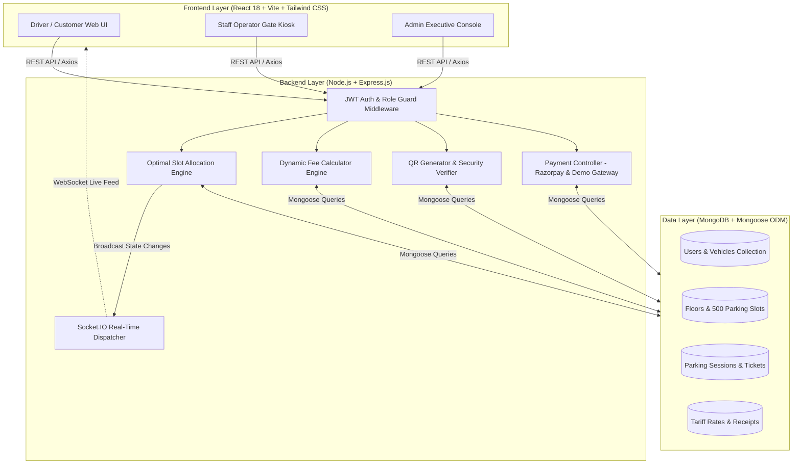

# 🅿️ SmartPark — Smart Mall Parking Management System (MERN Stack)

> **Enterprise Full-Stack B.Tech CSE Capstone Project**  
> A complete, responsive, full-stack Smart Mall Parking Management System demonstrating practical mastery of **MongoDB**, **Express.js**, **React.js**, **Node.js**, **REST APIs**, **Role-Based JWT Authentication**, **Dynamic Slot Allocation Algorithms**, **Digital QR-Code Ticketing**, **Tiered Fee Calculation Engine**, **Socket.IO Real-Time Telemetry**, and **Payment Gateway Integration**.

---

## 📌 Table of Contents
1. [Project Overview & Problem Statement](#-project-overview--problem-statement)
2. [End-to-End System Architecture](#-end-to-end-system-architecture)
3. [User Roles & Permissions](#-user-roles--permissions)
4. [Demo Credentials](#-demo-credentials)
5. [Parking Structure & Dynamic Slot Allocation](#-parking-structure--dynamic-slot-allocation)
6. [QR Code Ticketing & Exit Flow](#-qr-code-ticketing--exit-flow)
7. [Tiered Fee Calculation Engine](#-tiered-fee-calculation-engine)
8. [Folder & Directory Structure](#-folder--directory-structure)
9. [REST API Documentation](#-rest-api-documentation)
10. [Setup & Execution Guide](#-setup--execution-guide)
11. [B.Tech CSE Full-Stack Learning Deep-Dive](#-btech-cse-full-stack-learning-deep-dive)
12. [Common Errors & Solutions](#-common-errors--solutions)

---

## 🏬 Project Overview & Problem Statement

### The Problem
Traditional mall parking suffers from:
- Long queues at boom-barriers during peak shopping hours.
- Manual paper slips that get easily lost, damaged, or manipulated.
- Friction in manually computing hourly rates and disputed billing.
- Blind cruising inside multi-story parking decks searching for vacant spots.
- Lack of centralized management and analytics for mall operators.

### The SmartPark Solution
SmartPark replaces manual parking booths with a high-tech automated lifecycle:
1. **Real-time Vacancy Awareness**: Drivers and staff see live occupancy across all 3 mall floors.
2. **Dynamic Slot Allocation**: Backend algorithm matches vehicle type (Car, Bike, SUV, EV) to the nearest available compatible bay.
3. **Paperless Digital QR Passes**: Instant digital tickets with secure cryptographic verification tokens.
4. **Automated Tiered Billing**: Dynamic rates with complimentary 10-minute grace period and 24-hour daily caps.
5. **Instant Cashless Exit**: Scan QR ticket at the barrier, pay via UPI, Card, Net Banking, or Cash, and trigger automatic slot release with real-time Socket.IO broadcasts.

---

## 🏗️ End-to-End System Architecture



---

## 👥 User Roles & Permissions

The system implements strict **Role-Based Access Control (RBAC)**:

| Role | Permissions & Capabilities |
| :--- | :--- |
| **Customer** | Register/Login, manage vehicles (Car, Bike, SUV, EV), discover live slots, auto-allocate or reserve bays, generate digital QR tickets, view real-time duration, pay parking fee (UPI/Card/Cash), and download digital tax invoices. |
| **Staff Operator** | Gate operations kiosk, register incoming vehicles at entrance, search tickets by vehicle or ID, scan exit QR code with camera, inspect duration, collect cash/digital payment, release boom-barrier. Cannot modify system rates or delete floors. |
| **Admin** | Full executive access: live Recharts analytics (daily vehicles, revenue trends, peak parking hours, floor load), manage 3 floors, manage 500 slots, modify tiered tariff rates, manage user roles, and export audit reports as CSV. |

---

## 🔑 Demo Credentials

Run `npm run seed` in the backend folder to pre-populate all demo accounts and 500 parking slots:

| Role | Email Address | Password | Features Accessible |
| :--- | :--- | :--- | :--- |
| **Mall Admin** | `admin@smartpark.com` | `admin123` | Executive Analytics, Rates, 500 Slots, Floors, Users |
| **Staff Operator** | `staff@smartpark.com` | `staff123` | Entrance Barrier, QR Camera Scanner, Exit Cash Desk |
| **Customer 1** | `customer@smartpark.com` | `customer123` | Saved Vehicles, Active Pass, History, Profile |
| **Customer 2** | `priya@smartpark.com` | `customer123` | Saved SUV, Parking Reservation, Digital Invoices |

> 💡 **Quick Sign In**: The login screen features **1-Click Demo Fillers** to easily switch between Admin, Staff, and Customer without typing!

---

## 🅿️ Parking Structure & Dynamic Slot Allocation

### Multi-Story Layout (500 Slots Seeded in MongoDB)
- **Floor 1 (Ground Level)**: **150 Slots** (Car: 90 incl. 6 Accessible, Bike: 30, SUV: 20, EV: 10)
- **Floor 2 (Mezzanine Deck)**: **200 Slots** (Car: 130 incl. 8 Accessible, Bike: 30, SUV: 25, EV: 15)
- **Floor 3 (Upper Terrace)**: **150 Slots** (Car: 100 incl. 4 Accessible, Bike: 20, SUV: 20, EV: 10)
- **Total**: **500 Slots**

### Visual Status Indicators
- 🟢 **Available**: Ready to receive incoming vehicle.
- 🔴 **Occupied**: Vehicle parked; active session linked.
- 🟡 **Reserved**: Pre-booked bay.
- 🔵 **EV Station**: High-speed EV charging equipped bay.
- ⚫ **Maintenance**: Bay closed for cleaning or electrical repair.

### Dynamic Allocation Algorithm (`backend/services/allocationService.js`)
Instead of hardcoding a slot:
1. Evaluates incoming vehicle type:
   - `Car` -> Compatible with `Car`, `SUV` slots.
   - `Bike` -> Compatible strictly with designated `Bike` slots.
   - `SUV` -> Prioritizes large `SUV` slots, then standard `Car` bays.
   - `EV` -> Prioritizes slots with `isEV: true` and high-speed chargers.
2. Checks Accessibility requirement (`isAccessible: true`).
3. Checks floor preference (or prioritizes lowest floor ascending: Floor 1 -> Floor 2 -> Floor 3).
4. Atomically reserves candidate slot in MongoDB and emits Socket.IO event `slot_updated`.

---

## 🎫 QR Code Ticketing & Exit Flow

1. **Generation**: When vehicle entry is recorded, backend generates a unique ID (e.g. `SP-2026-000123`).
2. **HMAC Cryptographic Token**: Creates a SHA-256 HMAC verification token combining Ticket ID, Session ID, and the server's secret key.
3. **Payload**: High-resolution QR Data URL is generated containing only secure session references (no sensitive customer personal info is exposed in the QR).
4. **Exit Verification**:
   - Exit barrier camera scans the QR pass using `html5-qrcode`.
   - Backend extracts `ticketId`, locates active `ParkingSession`, and computes live duration in minutes.
   - Collects fee (or approves free exit if within grace period).
   - Marks slot as **Available** and triggers boom-barrier gate opening.

---

## 💰 Tiered Fee Calculation Engine

Stored dynamically in the `ParkingRate` collection in MongoDB:

| Vehicle Class | First Hour | Additional Hours | Maximum 24h Cap | Grace Period |
| :--- | :---: | :---: | :---: | :---: |
| **Car** | ₹30 | ₹20 / hr | ₹200 | 10 mins |
| **Bike** | ₹15 | ₹10 / hr | ₹100 | 10 mins |
| **SUV** | ₹40 | ₹25 / hr | ₹250 | 10 mins |
| **EV (Electric)** | ₹25 | ₹15 / hr | ₹180 | 15 mins |

### Calculation Rules (`backend/services/feeCalculatorService.js`):
1. **Grace Period**: If parking duration $\le$ Grace Period (10 mins), fee is **₹0**.
2. **Fractional Hours**: Any fraction of an additional hour is rounded up to the nearest whole hour.
3. **Daily Max Cap**: Billable hourly fees cannot exceed the maximum daily ceiling per 24 hours.

---

## 📁 Folder & Directory Structure

```
smartpark/
├── backend/
│   ├── config/
│   │   ├── db.js                 # MongoDB connection using Mongoose
│   │   └── razorpay.js           # Razorpay SDK initialization & Demo Mode fallback
│   ├── controllers/
│   │   ├── authController.js     # Register, Login, JWT issuing, Profile
│   │   ├── vehicleController.js  # Vehicle CRUD & parking protection
│   │   ├── parkingController.js  # Availability, Dynamic allocation, Entry, Exit
│   │   ├── ticketController.js   # Ticket lookup, user tickets, search
│   │   ├── paymentController.js  # Razorpay order, demo payments, receipts
│   │   ├── adminController.js    # Recharts analytics, user & slot management
│   │   └── notificationController.js # Real-time announcements & alerts
│   ├── middleware/
│   │   ├── authMiddleware.js     # Bearer JWT verification & Role checking
│   │   └── errorMiddleware.js    # Centralized 404 & error handlers
│   ├── models/
│   │   ├── User.js               # User schema with bcrypt password hashing
│   │   ├── Vehicle.js            # Vehicle registration schema
│   │   ├── ParkingFloor.js       # Floor schema
│   │   ├── ParkingSlot.js        # 500 Slot inventory schema
│   │   ├── ParkingSession.js     # Active/completed parking logs
│   │   ├── ParkingTicket.js      # Digital ticket with QR data
│   │   ├── Payment.js            # Payment transaction & receipt schema
│   │   ├── ParkingRate.js        # Dynamic vehicle pricing schema
│   │   └── Notification.js       # In-app notifications schema
│   ├── routes/                   # Clean Express router endpoints
│   ├── services/
│   │   ├── allocationService.js  # Optimal bay assignment algorithm
│   │   ├── feeCalculatorService.js # Duration & tiered tariff engine
│   │   ├── qrService.js          # QR Code generator & crypto verifier
│   │   └── socketService.js      # Socket.IO room & broadcast emitter
│   ├── seeds/
│   │   └── seedData.js           # 500 slots, 3 floors, demo users seeder
│   ├── utils/
│   │   └── idGenerator.js        # Unique ticket & receipt ID generation
│   ├── .env.example              # Sample environment variables
│   ├── package.json              # Backend dependencies
│   └── server.js                 # Express HTTP + Socket.IO server entry
│
├── frontend/
│   ├── src/
│   │   ├── api/
│   │   │   └── apiClient.js      # Axios client with JWT interceptors
│   │   ├── components/
│   │   │   ├── charts/           # Recharts analytics components
│   │   │   ├── common/           # Navbar, Footer, Modal, Badge, Loader, StatCard
│   │   │   ├── parking/          # FloorMap, SlotCard, DigitalTicket, ReceiptCard
│   │   │   └── qr/               # QRScannerModal (camera scanner)
│   │   ├── context/
│   │   │   ├── AuthContext.jsx   # Authentication & user state
│   │   │   ├── SocketContext.jsx # Live WebSocket listener & rooms
│   │   │   └── NotificationContext.jsx # Toast notifications
│   │   ├── pages/
│   │   │   ├── Home.jsx          # Public landing page
│   │   │   ├── Login.jsx         # Sign in with 1-click demo buttons
│   │   │   ├── Register.jsx      # Customer registration
│   │   │   ├── ForgotPassword.jsx# Password recovery UI
│   │   │   ├── customer/         # Dashboard, FindParking, MyVehicles, Tickets, History, Profile
│   │   │   ├── staff/            # StaffDashboard, VehicleEntry, VehicleExit
│   │   │   ├── admin/            # AdminDashboard, FloorManagement, SlotManagement, Rates, Users, Reports
│   │   │   ├── payment/          # PaymentPage, ReceiptPage
│   │   │   └── NotFound.jsx      # 404 page
│   │   ├── layouts/              # MainLayout, DashboardLayout
│   │   ├── App.jsx               # React Router DOM v6 route definitions
│   │   ├── index.css             # Tailwind directives & print styles
│   │   └── main.jsx              # Vite entry mount
│   ├── index.html
│   ├── tailwind.config.js        # Mall-tech theme colors
│   ├── vite.config.js            # Proxy to Express backend
│   └── package.json              # Frontend dependencies
│
├── .gitignore
├── package.json                  # Workspace orchestrator scripts
└── README.md                     # Comprehensive academic documentation
```

---

## 🌐 REST API Documentation

### Authentication (`/api/auth`)
- `POST /api/auth/register` — Register a customer with name, email, phone, and password.
- `POST /api/auth/login` — Authenticate and return signed JWT token.
- `GET /api/auth/profile` — Fetch current user profile and registered vehicles count (*Protected*).
- `PUT /api/auth/profile` — Update user name, phone, or password (*Protected*).

### Parking & Slot Management (`/api/parking`)
- `GET /api/parking/availability` — Summary counts (total, available, occupied, reserved) and floor breakdown.
- `GET /api/parking/floors` — List active parking floors.
- `GET /api/parking/slots` — List slots with optional filters (`floorNumber`, `vehicleType`, `status`, `isEV`).
- `POST /api/parking/allocate` — Run allocation algorithm to query the best vacant bay.
- `POST /api/parking/entry` — Create active parking session, occupy slot, and generate QR ticket (*Protected*).
- `POST /api/parking/exit-lookup` — Scan QR or input ticket ID to compute exact duration & fee.
- `POST /api/parking/exit` — Settle parking bill, mark session completed, and release slot (*Protected*).

### Payments (`/api/payments`)
- `POST /api/payments/create-order` — Initialize Razorpay order or SmartPark Demo Order.
- `POST /api/payments/verify` — Verify transaction signature, generate receipt ID, mark session paid.
- `GET /api/payments/history` — Fetch user transaction history (*Protected*).
- `GET /api/payments/receipt/:receiptId` — Get digital tax receipt details.

### Admin Controls (`/api/admin`)
- `GET /api/admin/dashboard` — Live counts, today's vehicles, today's revenue, active sessions.
- `GET /api/admin/analytics` — Historical 7-day vehicle flow, revenue trends, peak hours, floor load.
- `GET /api/admin/users` — List registered customers and staff operators.
- `PUT /api/admin/users/:id` — Update role or toggle account active/inactive status.
- `GET /api/admin/rates` — Fetch current vehicle tariff rates.
- `PUT /api/admin/rates` — Update first-hour, additional-hour, max-daily, and grace periods.

---

## 🚀 Setup & Execution Guide

### Prerequisites
- [Node.js](https://nodejs.org/) (v18.x or v20.x recommended)
- [MongoDB](https://www.mongodb.com/) (Local Community Server running on `localhost:27017` or MongoDB Atlas URI)

---

### Step 1: Install Dependencies
Open a terminal in the root `SmartPark` folder:

```bash
# 1. Install Backend Dependencies
cd backend
npm install

# 2. Install Frontend Dependencies
cd ../frontend
npm install
```

---

### Step 2: Configure Environment Variables
The backend `.env` file is already created in `backend/.env`. You can customize it if needed:

```env
PORT=5000
NODE_ENV=development
MONGO_URI=mongodb://127.0.0.1:27017/smartpark
JWT_SECRET=smartpark_super_secret_jwt_key_2026_cse_project
JWT_EXPIRE=30d
CLIENT_URL=http://localhost:5173

# Optional: Razorpay test keys (Leave blank or placeholder for automatic Demo Payment Mode)
RAZORPAY_KEY_ID=
RAZORPAY_KEY_SECRET=
```

---

### Step 3: Seed Database with 500 Slots & Demo Accounts
Run the automated seed script to generate all 3 floors, 500 parking slots, tariff rates, demo vehicles, and active sessions:

```bash
cd backend
npm run seed
```

*Console output will display confirmation of 500 slots, floors, and default demo credentials.*

---

### Step 4: Run the Application

#### Terminal 1 — Start Express Backend:
```bash
cd backend
npm run dev
```
*Backend runs on `http://localhost:5000` with WebSocket server attached.*

#### Terminal 2 — Start React Frontend:
```bash
cd frontend
npm run dev
```
*Frontend runs on `http://localhost:5173`.*

---

## 🎓 B.Tech CSE Full-Stack Learning Deep-Dive

### 1. Why MongoDB & Mongoose?
- **Schema Validation**: Parking bays require strict state management (`Available`, `Occupied`, `Reserved`, `Maintenance`). Mongoose Enums prevent invalid states.
- **Compound Indexes**: Indexed queries on `{ floorId: 1, status: 1 }` and `{ vehicleType: 1, status: 1 }` ensure that searching among 500 slots completes in sub-millisecond time.
- **Atomic Updates**: When allocating a slot, MongoDB's `findOneAndUpdate` ensures that two simultaneous vehicle entries cannot reserve the same parking slot.

### 2. Why Express.js & Node.js?
- **Asynchronous Non-Blocking I/O**: Node's event loop handles hundreds of concurrent QR scans and barrier triggers without thread starvation.
- **Middleware Chain**: Separation of concerns where requests pass through:
  `cors()` $\rightarrow$ `express.json()` $\rightarrow$ `protect` (JWT validation) $\rightarrow$ `authorize` (Role checking) $\rightarrow$ Controller $\rightarrow$ `errorHandler`.

### 3. Why React 18 & Vite?
- **Fast HMR**: Vite leverages native ES modules in the browser, providing instant build feedback.
- **Context API State**: `AuthContext` provides global user session, while `SocketContext` provides real-time event distribution to any component on the screen without prop drilling.

### 4. Why Socket.IO?
- Rather than having hundreds of clients poll `GET /api/parking/availability` every 2 seconds (which wastes server CPU and bandwidth), Socket.IO maintains an open WebSocket duplex connection.
- When any vehicle enters or leaves, the backend emits `slot_updated`, immediately painting the slot green or red on every open screen in real time.

---

## 🛠️ Common Errors & Solutions

| Error | Root Cause | Solution |
| :--- | :--- | :--- |
| `MongooseServerSelectionError: connect ECONNREFUSED 127.0.0.1:27017` | Local MongoDB service is not started. | Run `net start MongoDB` in Windows Command Prompt (as Administrator) or verify MongoDB Compass connection. |
| `EADDRINUSE: address already in use :::5000` | Port 5000 is occupied by another process. | In PowerShell run: `Stop-Process -Id (Get-NetTCPConnection -LocalPort 5000).OwningProcess -Force` |
| `401 Unauthorized: Invalid or expired token` | JWT token expired or missing in request header. | Log out and log back in to generate a fresh 30-day JWT token stored in `localStorage`. |
| `Camera permission denied for QR scanning` | Browser blocked webcam access for localhost. | Click the camera icon in the browser address bar $\rightarrow$ select "Always allow" $\rightarrow$ or use the manual Ticket ID input. |
| `CORS Error when making API calls` | Frontend origin does not match backend CORS policy. | `server.js` is already configured to permit `http://localhost:5173`. Ensure frontend is running on port 5173 or update `CLIENT_URL` in `backend/.env`. |

---

## 📜 Academic Declaration & Authorship
This project is developed as a complete full-stack CSE capstone project adhering to clean code standards, modular MVC architecture, secure RESTful design, and enterprise-grade UI/UX.
